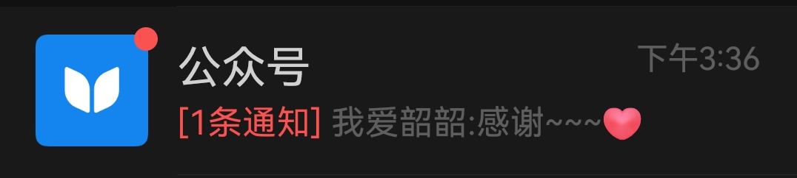
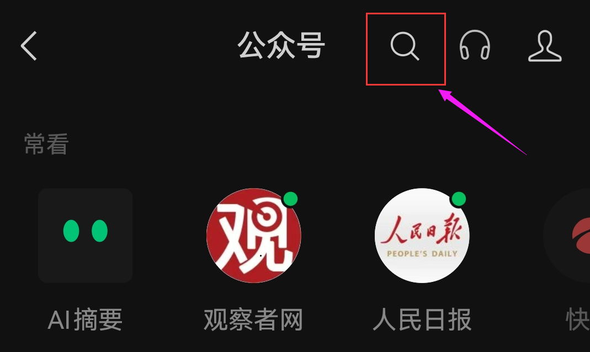
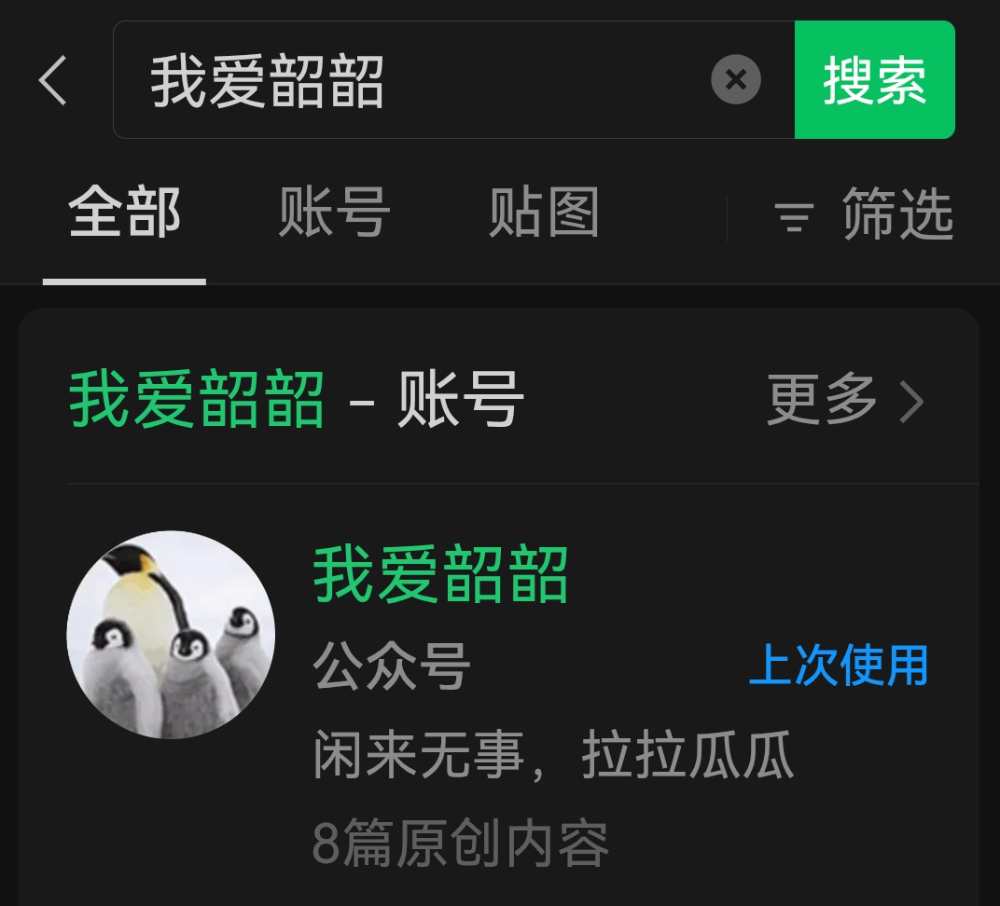
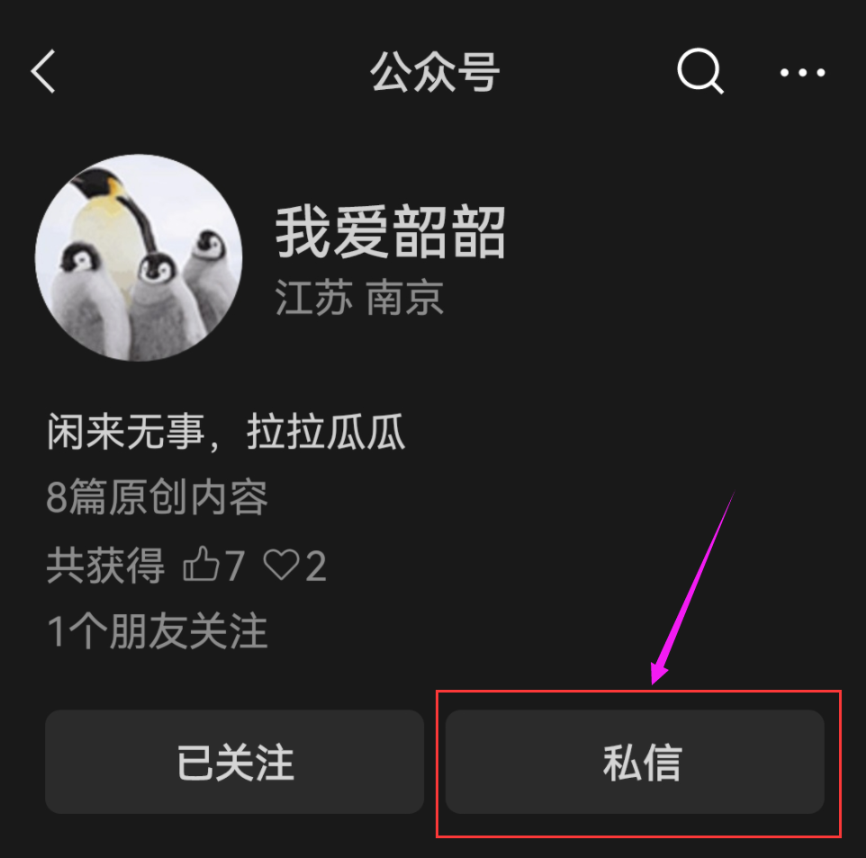
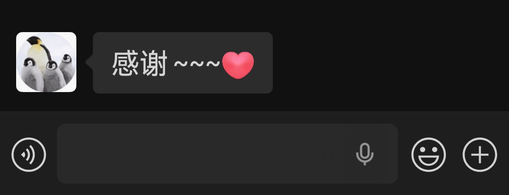

敬爱的读者，你好：

本课程完全是作者本人业余时间的作品，创作不易，如果您觉得本课程对您的学习有帮助的话，欢迎给本课程打赏。

打赏方法：可以进入作者的微信公众号 **“我爱韶韶”** 后选择任意一篇文章并通过对该文章打赏即可，金额不限。在此先谢过了。

**打赏金额每满 10 元免费赠送课程相关的咨询一次（即累积 10 元可抵一次，譬如累积 20 元可抵两次，依次类推）**。

有关免费课程咨询操作可以在关注作者的微信公众号 **“我爱韶韶”** 后私信作者沟通。具体方法如下：

一种方法是直接在手机上打开微信 APP，通过右上角的 “扫一扫” 功能扫描上图的作者公众号二维码，直接进入公众号的 “私信” 对话窗口。

或者采用以下步骤：

**步骤一**：首先在手机上打开微信 APP 界面，点击左下角 “微信” 图标后找到 “公众号” 入口，点击进入微信公众号主界面。

**步骤二**：在微信公众号主界面中点击上方 “搜索” 图标。

**步骤三**：在搜索对话框中输入 “我爱韶韶” 四个字，即作者的公众号名称。此时应该在下方出现作者公众号的入口界面。点击该界面。

**步骤四**：在 **“我爱韶韶”** 公众号主页中有一个 “私信” 按钮，点击该按钮。

**步骤五**：进入私信对话窗口，此时可以在这里联系作者。

**注：由于作者并非专职课程答疑，所以回复可能不那么及时，如有延迟还请多多包涵。**

